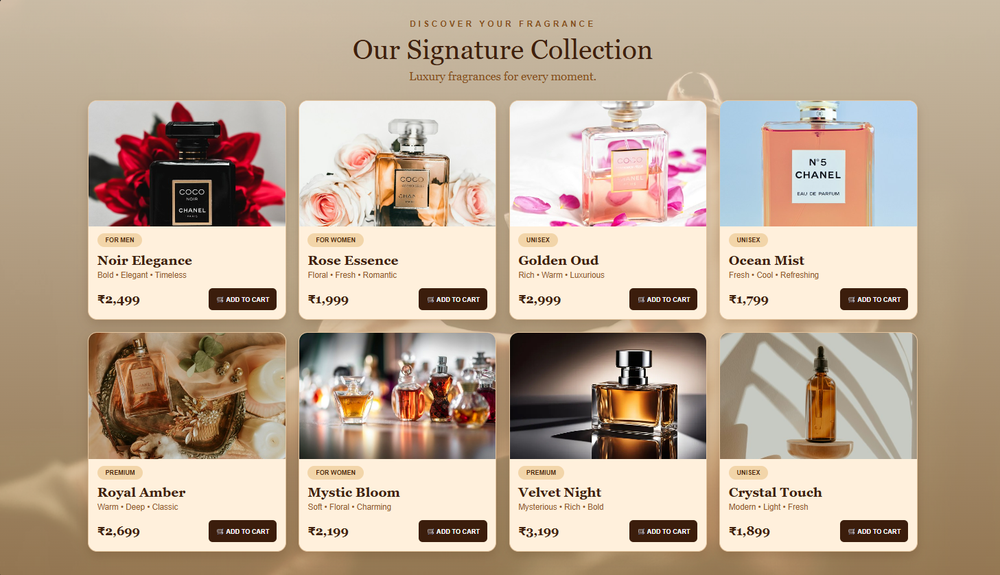

# Commercial-Website
# Ex02 Commercial Website
## Date:31/10/2026

## AIM
To create a commercial website using CSS Flexbox.

## ALGORITHM
### STEP 1
Create an HTML file (index.html)

### STEP 2
Create a CSS file (style.css)

### STEP 3
Include a navigation bar with links to different sections.

### STEP 4
Add structured sections for Homepage, Products / Services, About Us, Contact Details and User Account.

### STEP 5
Include social media links at the footer with copyright information.

### STEP 6
Define global styles for fonts, colors, and layout.

### STEP 7
Style the header, navigation bar, and sections.

### STEP 8
Use Flexbox for layout design.

### STEP 9
Add hover effects and transitions for interactivity.

### STEP 10
Add Images and Media.

### STEP 11
Use optimized images for a professional look.

### STEP 12
Open the HTML file in a browser to check layout and functionality.

### STEP 13
Fix styling issues and refine content placement.

### STEP 14
Deploy the website.

### STEP 15
Upload to GitHub Pages for free hosting.
## Devoleped by: Kaviya R
## Reg No: 212225040179
## PROGRAM
## HTML
```

<!DOCTYPE html>
<html lang="en">
<head>
    <meta charset="UTF-8">
    <meta name="viewport" content="width=device-width, initial-scale=1.0">
    <title>LUXORA - Signature Collection</title>
    <link rel="stylesheet" href="style.css">
</head>
<body>

<section class="collection" id="collection">

    <div class="section-heading">
        <p>DISCOVER YOUR FRAGRANCE</p>
        <h1>Our Signature Collection</h1>
        <span>Luxury fragrances for every moment.</span>
    </div>

    <div class="product-container">

        <!-- Product 1 -->
        <div class="product-card">
            
            <div class="details">
                <span class="category">FOR MEN</span>
                <h2>Noir Elegance</h2>
                <p>Bold • Elegant • Timeless</p>
                <div class="bottom">
                    <strong>₹2,499</strong>
                    <button>🛒 ADD TO CART</button>
                </div>
            </div>
        </div>

        <!-- Product 2 -->
        <div class="product-card">
            
            <div class="details">
                <span class="category">FOR WOMEN</span>
                <h2>Rose Essence</h2>
                <p>Floral • Fresh • Romantic</p>
                <div class="bottom">
                    <strong>₹1,999</strong>
                    <button>🛒 ADD TO CART</button>
                </div>
            </div>
        </div>

        <!-- Product 3 -->
        <div class="product-card">
            
            <div class="details">
                <span class="category">UNISEX</span>
                <h2>Golden Oud</h2>
                <p>Rich • Warm • Luxurious</p>
                <div class="bottom">
                    <strong>₹2,999</strong>
                    <button>🛒 ADD TO CART</button>
                </div>
            </div>
        </div>

        <!-- Product 4 -->
        <div class="product-card">
            
            <div class="details">
                <span class="category">UNISEX</span>
                <h2>Ocean Mist</h2>
                <p>Fresh • Cool • Refreshing</p>
                <div class="bottom">
                    <strong>₹1,799</strong>
                    <button>🛒 ADD TO CART</button>
                </div>
            </div>
        </div>

        <!-- Product 5 -->
        <div class="product-card">
            
            <div class="details">
                <span class="category">PREMIUM</span>
                <h2>Royal Amber</h2>
                <p>Warm • Deep • Classic</p>
                <div class="bottom">
                    <strong>₹2,699</strong>
                    <button>🛒 ADD TO CART</button>
                </div>
            </div>
        </div>

        <!-- Product 6 -->
        <div class="product-card">
           
            <div class="details">
                <span class="category">FOR WOMEN</span>
                <h2>Mystic Bloom</h2>
                <p>Soft • Floral • Charming</p>
                <div class="bottom">
                    <strong>₹2,199</strong>
                    <button>🛒 ADD TO CART</button>
                </div>
            </div>
        </div>

        <!-- Product 7 -->
        <div class="product-card">
            
            <div class="details">
                <span class="category">PREMIUM</span>
                <h2>Velvet Night</h2>
                <p>Mysterious • Rich • Bold</p>
                <div class="bottom">
                    <strong>₹3,199</strong>
                    <button>🛒 ADD TO CART</button>
                </div>
            </div>
        </div>

        <!-- Product 8 -->
        <div class="product-card">
            
            <div class="details">
                <span class="category">UNISEX</span>
                <h2>Crystal Touch</h2>
                <p>Modern • Light • Fresh</p>
                <div class="bottom">
                    <strong>₹1,899</strong>
                    <button>🛒 ADD TO CART</button>
                </div>
            </div>
        </div>

    </div>
</section>

</body>
</html>
```
## CSS

```

* {
    margin: 0;
    padding: 0;
    box-sizing: border-box;
}

body {
    font-family: Georgia, serif;
    background: #f5dfc2;
    color: #42230f;
}

/* Main Collection Background */
.collection {
    width: 100%;
    min-height: 100vh;
    padding: 35px 6%;
    background:
        linear-gradient(rgba(255, 237, 210, 0.78),
                        rgba(225, 180, 125, 0.65)),
        url("https://images.unsplash.com/photo-1515377905703-c4788e51af15?w=1600");
    background-size: cover;
    background-position: center;
    background-attachment: fixed;
}

/* Heading */
.section-heading {
    text-align: center;
    margin-bottom: 30px;
}

.section-heading p {
    font-family: Arial, sans-serif;
    font-size: 14px;
    letter-spacing: 5px;
    font-weight: bold;
    color: #87501e;
    margin-bottom: 10px;
}

.section-heading h1 {
    font-size: 48px;
    font-weight: normal;
    margin-bottom: 8px;
    color: #40200d;
}

.section-heading span {
    font-size: 20px;
    color: #87501e;
}

/* Product Grid */
.product-container {
    display: grid;
    grid-template-columns: repeat(4, minmax(0, 1fr));
    gap: 22px;
    max-width: 1450px;
    margin: auto;
}

/* Product Card */
.product-card {
    background: #fff0dc;
    border: 2px solid #e4c49e;
    border-radius: 16px;
    overflow: hidden;
    box-shadow: 0 7px 18px rgba(79, 43, 16, 0.2);
    transition: 0.3s ease;
}

.product-card:hover {
    transform: translateY(-8px);
    box-shadow: 0 14px 25px rgba(79, 43, 16, 0.3);
}

.product-card img {
    width: 100%;
    height: 220px;
    object-fit: cover;
    display: block;
    transition: 0.4s;
}

.product-card:hover img {
    transform: scale(1.04);
}

/* Product Details */
.details {
    padding: 12px 15px 16px;
}

.category {
    display: inline-block;
    background: #f2d5a9;
    color: #512c12;
    padding: 6px 14px;
    border-radius: 20px;
    font-family: Arial, sans-serif;
    font-size: 11px;
    font-weight: bold;
}

.details h2 {
    font-size: 23px;
    margin: 9px 0 5px;
    color: #40200d;
}

.details p {
    font-family: Arial, sans-serif;
    color: #95602e;
    font-size: 14px;
    margin-bottom: 15px;
}

/* Price and Button */
.bottom {
    display: flex;
    justify-content: space-between;
    align-items: center;
    gap: 8px;
}

.bottom strong {
    font-size: 21px;
    white-space: nowrap;
}

.bottom button {
    background: #3b1d0c;
    color: white;
    border: none;
    border-radius: 7px;
    padding: 12px 13px;
    font-size: 11px;
    font-weight: bold;
    cursor: pointer;
    transition: 0.3s;
}

.bottom button:hover {
    background: #a66c2d;
}

/* Tablet */
@media (max-width: 1000px) {
    .product-container {
        grid-template-columns: repeat(2, minmax(0, 1fr));
    }
}

/* Mobile */
@media (max-width: 550px) {
    .collection {
        padding: 30px 15px;
    }

    .section-heading h1 {
        font-size: 32px;
    }

    .section-heading span {
        font-size: 15px;
    }

    .product-container {
        grid-template-columns: 1fr;
    }

    .product-card img {
        height: 250px;
    }
}
```
## OUTPUT



## RESULT
The program for creating commercial website using CSS Flexbox is executed successfully.
